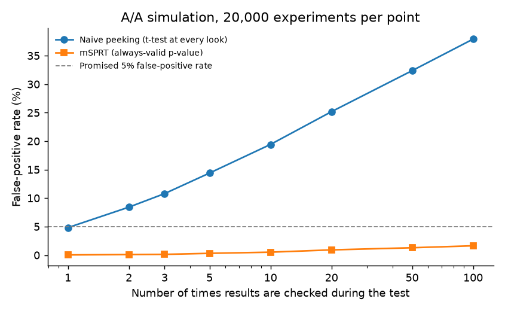
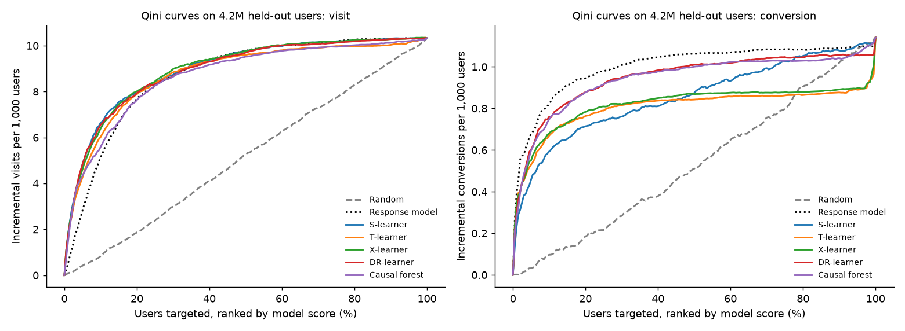

# Experimentation & Causal Decision Engine

A tested Python toolkit for analysing A/B tests correctly and for deciding **whom to treat**,
applied to two large public datasets: 78 real A/B experiments from ASOS and a 14-million-user ad
experiment from Criteo.

[](.github/workflows/ci.yml)


**Headline results**

- Checking A/B test results every day and stopping at the first p < 0.05 **doubled the number of
  "wins"** across 381 real experiment-metrics (224 vs 105). **36 of those wins had flipped to
  losses** by the end of the test. A sequential test (mSPRT) keeps the false-positive rate under
  5% and still reaches clear decisions after a median of **24% of the planned duration**.
- Choosing who sees an ad with an uplift model gives **60 incremental visits per 1,000 treated
  users vs 52 for the usual "most likely to visit" model (+16%) and 6 for random targeting (10x)**,
  measured on 4.2M held-out users with paired bootstrap CIs.
- A randomization check on the Criteo data found a small feature imbalance. That imbalance made
  the naive treatment effect **about 40% too large** (+1.03 vs +0.73 visit points). Doubly robust
  estimation and DoWhy refutation tests confirm the corrected figure.

---

## Why this project

Most experimentation mistakes are not modeling mistakes; they are process mistakes:

1. **Peeking**: stopping a test as soon as it looks significant inflates false positives from 5%
   to about 20%.
2. **Ignoring validity checks**: a broken 50/50 split (sample ratio mismatch) makes every number
   downstream meaningless.
3. **Targeting by outcome instead of uplift**: "who is most likely to buy?" is not "who buys
   *because of* the offer?"

This repository implements the methods that fix each of these, tests them against known answers,
and applies them to real data.

## Results at a glance

### Case study A: 78 real A/B experiments (ASOS)



| | Result |
|---|---|
| Reproduces the paper's published significance counts (Welch t-test and mSPRT, 4 metrics) | 8 of 8 exact matches |
| Experiments failing the sample ratio mismatch check / with split drift over time | 9 / 5 |
| Significant at the planned end vs with daily peeking | 105 vs **224** |
| Peeking-only "wins" that reversed direction by the end | **36** |
| Median time to a decision with mSPRT (when the effect is real) | **24%** of planned duration |
| Discoveries after false discovery rate control (Benjamini-Hochberg) | 68 of 105 |
| Median detectable effect at final sample size | 0.63% relative |

Full write-up: [`reports/asos_report.md`](reports/asos_report.md) · Decision memo:
[`memos/asos_memo.md`](memos/asos_memo.md)

### Case study B: uplift targeting on 14M users (Criteo)



| Visits, top 10% targeted | Incremental visits per 1,000 treated (covariate-adjusted) | Qini coefficient (95% CI) |
|---|---|---|
| Random | 6.0 | 0.0000 |
| Response model (baseline) | 51.9 | 0.00354 (0.00334 to 0.00375) |
| **X-learner** | **60.1** | **0.00380** (0.00362 to 0.00406) |
| DR-learner | 60.0 | 0.00375 (0.00358 to 0.00396) |
| S-learner | 60.0 | 0.00381 (0.00362 to 0.00403) |

- The top 20% of users chosen by the X-learner capture **78%** of all incremental visits.
- An honest negative result: **for rare conversions (0.3%), no uplift model beat the simple
  response model**, so the memo recommends the simpler model there.

Full write-up: [`reports/criteo_report.md`](reports/criteo_report.md) · Decision memo:
[`memos/criteo_memo.md`](memos/criteo_memo.md)

## The toolkit

`src/experiment_toolkit/` is a small, typed package. Every module is unit-tested against a
textbook value, a reference implementation, or a simulation with a known true effect.

| Module | What it does |
|---|---|
| `design` | Sample size, minimum detectable effect, power |
| `checks` | Sample ratio mismatch test, covariate balance |
| `frequentist` | Welch test from summary stats or raw data, relative-lift CI (delta method), ratio metrics, Benjamini-Hochberg |
| `cuped` | CUPED variance reduction with a pre-experiment covariate |
| `sequential` | mSPRT always-valid p-values and confidence sequences, peeking simulation |
| `bayesian` | Beta-Binomial and Normal models, P(better), expected loss, empirical-Bayes prior |
| `uplift` | S/T/X/DR meta-learners, AIPW effect estimate, Qini curve and coefficient, uplift@k, paired Poisson bootstrap |
| `causal` | DoWhy effect estimation with placebo, random-confounder, and subset refutations |
| `cli` | `abtest` command: full analysis of a simulated experiment with a known answer |

```text
$ abtest --n 60000 --lift 0.05
Simulated 120,000 users | true relative lift = +5.0% | baseline conversion = 10.0%

== 1. Design ===================================================
Users per arm needed to detect +5.0% on conversion (80% power): 57,760
Users per arm in this experiment: 59,849 / 60,151
Achieved power for the true lift: 82%

== 2. Sample ratio mismatch check ==============================
Split 49.87% / 50.13%, p = 0.383 -> OK

== 3. Fixed-horizon tests ======================================
Conversion: lift +4.23% (95% CI +0.71% to +7.75%), p = 0.0161

== 4. CUPED on spend (pre-period spend as covariate) ===========
Raw:   lift +4.87% (CI +4.28% to +5.46%), p = 6.31e-61
CUPED: lift +4.98% (CI +4.55% to +5.40%), p = 1.78e-122
Variance reduction: 49.0%

== 5. Sequential test (mSPRT), 10 looks ========================
Always-valid p-value by look: 1.000, 1.000, 1.000, 1.000, 1.000, 0.354, 0.329, 0.187, 0.187, 0.187
Never crossed p < 0.05: keep running or accept that the effect is too small to see

== 6. Bayesian decision (Beta-Binomial) ========================
P(treatment better) = 99.2%
Expected loss if we ship = 4.58e-06 (conversion-rate units)
Decision rule P > 95%: SHIP
```

The sequential test does not stop here even though the fixed test is significant. That is the
price of being allowed to peek: an always-valid test needs more evidence than a single
end-of-test look, so it shines on clear effects and is conservative on borderline ones.

## Reproduce

Requires Python 3.11 or 3.12 and [uv](https://docs.astral.sh/uv/) (or plain pip). Everything runs
on a laptop CPU; no API keys or GPU needed.

```bash
make setup     # create .venv and install the package with case-study extras
make test      # 36 unit tests
make data      # download ASOS (1 MB) and Criteo (311 MB) into data/raw/
make asos      # case study A, about 10 seconds
make criteo    # case study B, about 15 minutes on the full data
```

To iterate faster on Criteo: `python case_studies/criteo/run_all.py --train-rows 1000000`.

## Repository layout

```text
├── src/experiment_toolkit/     # the package (design, checks, cuped, sequential, bayesian, uplift, causal, cli)
├── tests/                      # unit tests, all against known answers
├── case_studies/
│   ├── asos/run_all.py         # A/B test re-analysis
│   └── criteo/
│       ├── sql/eda.sql         # DuckDB SQL: arm sizes, naive ATE, funnel, exposure
│       ├── prepare.py          # CSV -> parquet, train/test split, randomization checks
│       └── run_all.py          # uplift models, evaluation, ATE, refutations
├── reports/                    # write-ups, figures, result tables (CSV/JSON)
├── memos/                      # one-page decision memos for non-technical readers
├── scripts/download_data.py
└── .github/workflows/ci.yml    # lint + tests on every push
```

## Design decisions

- **Meta-learners are implemented from scratch** (about 150 lines) on top of any scikit-learn
  estimator, so the logic is visible and testable. EconML is used only for the causal forest.
- **Base learner: scikit-learn `HistGradientBoosting`**, the same histogram algorithm as
  LightGBM, with no native OpenMP dependency, so it installs anywhere and CI stays simple.
- **Evaluation on a held-out 30% split with a paired bootstrap**: every model is scored on the
  same resampled users, so the confidence interval of the difference between two models is
  valid, not just each model's own interval.
- **Ties in model scores are broken at random**, not by row order. Tree models produce many ties,
  and the raw Criteo file is sorted, so row-order tie-breaking silently corrupts Qini curves.
- **Every figure and number is produced by a script**, so results reproduce without notebooks.

## Limitations

- ASOS data is aggregated per arm, so CUPED cannot be applied to it; CUPED is demonstrated on
  simulated data. ASOS metrics are anonymised, so "higher is better" is assumed.
- Criteo features are anonymised, and treatment means "eligible for ad" (intent-to-treat).
- The causal forest is trained on a 300k-row subsample because of laptop compute.
- The cost and value figures in the Criteo memo are illustrative assumptions.

## References

- Liu, Cardoso, Couturier, McCoy (2021). *Datasets for Online Controlled Experiments*. NeurIPS Datasets and Benchmarks. [arXiv:2111.10198](https://arxiv.org/abs/2111.10198)
- Diemert, Betlei, Renaudin, Amini (2018). *A Large Scale Benchmark for Uplift Modeling*. AdKDD.
- Johari, Koomen, Pekelis, Walsh (2017). *Peeking at A/B Tests*. KDD. [arXiv:1512.04922](https://arxiv.org/abs/1512.04922)
- Deng, Xu, Kohavi, Walker (2013). *Improving the Sensitivity of Online Controlled Experiments by Utilizing Pre-Experiment Data* (CUPED). WSDM.
- Künzel, Sekhon, Bickel, Yu (2019). *Metalearners for Estimating Heterogeneous Treatment Effects*. PNAS.
- Kennedy (2020). *Towards Optimal Doubly Robust Estimation of Heterogeneous Causal Effects*. [arXiv:2004.14497](https://arxiv.org/abs/2004.14497)
- Benjamini, Hochberg (1995). *Controlling the False Discovery Rate*. JRSS-B.
