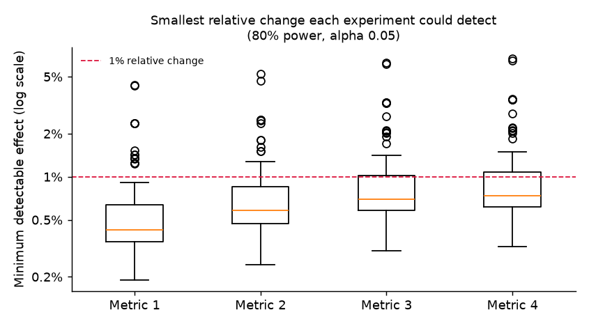
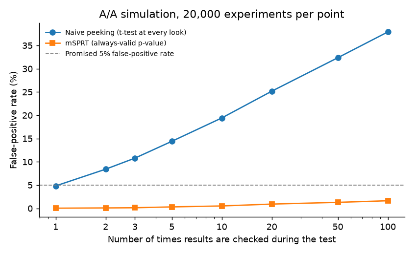
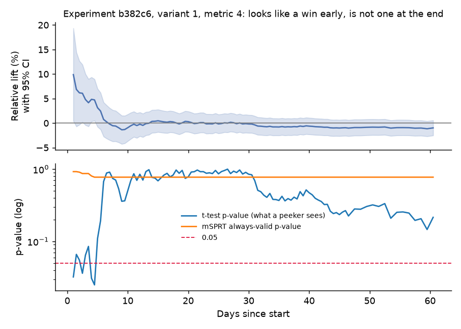
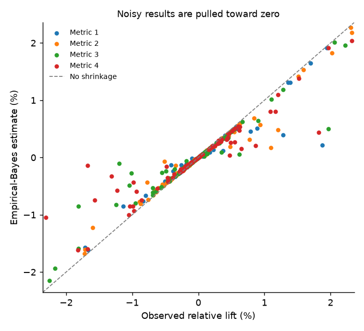

# Case study A: re-analysing 78 real A/B experiments from ASOS

**Data.** [ASOS Digital Experiments Dataset](https://osf.io/64jsb/) (Liu et al., NeurIPS 2021
Datasets track, [arXiv:2111.10198](https://arxiv.org/abs/2111.10198)). 78 real experiments run
by the online fashion retailer ASOS, 99 treatment-vs-control comparisons, 4 anonymised decision
metrics, and cumulative daily or 12-hourly checkpoints of mean, variance and user count for each
arm. After dropping checkpoints with missing variances, 381 comparison-metric time series remain.

**Code.** [`case_studies/asos/run_all.py`](../case_studies/asos/run_all.py), which uses the
tested toolkit in [`src/experiment_toolkit`](../src/experiment_toolkit). Runs in about 7 seconds.
Every number below is in [`reports/asos/results.json`](asos/results.json) and the CSVs next to it.

---

## 1. Sanity check: the pipeline reproduces the paper

The paper (Table 2) reports how many experiments are significant at the end under a Welch
t-test and under mSPRT. This project recomputes both from the raw checkpoints:

| Metric | Welch t-test significant, paper | this project | mSPRT significant, paper | this project |
|---|---|---|---|---|
| 1 | 26 | **26** | 21 | **21** |
| 2 | 27 | **27** | 38 | **38** |
| 3 | 25 | **25** | 22 | **22** |
| 4 | 27 | **27** | 20 | **20** |

All eight counts match exactly. That gives confidence that the rest of the analysis is built on a
correct implementation.

## 2. Data validity: sample ratio mismatch (SRM)

Before reading any result, check that users were split the way the experiment intended.

- 96 of 99 comparisons look like 50/50 designs (observed share between 45% and 55%). The other 3
  are clearly deliberate unequal splits (3%, 67%, 89% treated) whose planned ratio is not in the
  dataset, so they cannot be tested.
- **9 of the 96 fail the SRM test** (chi-square, p < 0.001). Four of these (two experiments, two
  variants each) show exactly 49.25% treated for both variants, which looks like a deliberate
  allocation rather than a bug. Others (for example 46.2% treated on 10.8M users) would be
  investigated before trusting the result. With 100M+ users even a 49.98% split is flagged, which
  is statistically real but tiny in practice.
- A second check that needs no knowledge of the plan: new users arriving in each interval should
  split with the same probability over time. **5 comparisons show the split ratio drifting during
  the experiment** (p < 0.001), a classic sign of a logging or assignment change mid-test.

Table: [`reports/asos/srm_checks.csv`](asos/srm_checks.csv).

## 3. How sensitive were these experiments?

At their final sample size, the median experiment could reliably detect (80% power) a **0.63%
relative change**; 78% of experiment-metrics were powered to detect a 1% change. Metric 4 is the
noisiest. When an experiment with an MDE of 2% reports "no significant effect", it means
"we could not see anything smaller than 2%", not "there is no effect".

## 4. The peeking problem

### 4a. Simulation with a known answer

20,000 A/A experiments per point (no true effect, so every "win" is a false positive), checked
at equally spaced looks:

| Looks during the test | 1 | 2 | 5 | 10 | 20 | 100 |
|---|---|---|---|---|---|---|
| Naive peeking false-positive rate | 4.8% | 8.4% | 14.4% | **19.4%** | 25.2% | 37.9% |
| mSPRT false-positive rate | 0.0% | 0.1% | 0.3% | **0.5%** | 0.9% | 1.6% |

Checking a t-test every day for 10 days and stopping at the first p < 0.05 turns a promised 5%
error rate into about 19%. The always-valid mSPRT p-value stays under 5% however often you look.

### 4b. Replaying the real experiments

Each of the 381 series was replayed checkpoint by checkpoint under three rules:

| Stopping rule | Declared significant (of 381) |
|---|---|
| Fixed horizon (test once at the planned end) | 105 |
| **Naive peeking** (stop at the first daily p < 0.05) | **224** |
| mSPRT (stop at the first always-valid p < 0.05) | 101 |

- Naive peeking more than doubles the number of "wins". **119 series were declared significant
  at some checkpoint but were not significant at the planned end**, and **36 of those had the
  opposite sign by the end**: a team peeking daily would have shipped changes that were actually
  hurting the metric.
- The median peeking-only "win" appeared just 13% of the way into the experiment, when samples
  were smallest and estimates noisiest.
- mSPRT agrees with the fixed-horizon test on 70 series, and when both say significant, mSPRT
  reached its decision after a **median of 24% of the planned duration**. That is the real
  benefit: safe early stopping, roughly 4x faster for clear effects.

The example above is the most extreme case: the t-test p-value dips below 0.05 on days 1 to 4
while the estimated lift is +5% to +10%; by the end the lift is about -1% and p = 0.2. The mSPRT
p-value never crosses 0.05.

**Prior for mSPRT.** The mixing variance tau^2 was learned per metric from the spread of
standardised end-of-experiment effects across all experiments, after subtracting sampling noise
(method of moments). This uses end-of-experiment data from the same experiments, as the paper
does; in production it would be learned from past experiments only.

## 5. Multiple testing

Each comparison is tested on 4 metrics, and there are 99 comparisons, so 381 tests in total. At
alpha = 0.05, about 19 "significant" results would be expected from noise alone if nothing
worked. Controlling the false discovery rate at 5% with Benjamini-Hochberg leaves **68 discoveries
out of 105 nominally significant results**.

## 6. Bayesian decisions with an empirical-Bayes prior

For each metric, the prior for the true relative lift is N(0, V^2), with V learned from all 99
comparisons (again by subtracting sampling noise from the observed spread). Each experiment then
gets P(improvement) and the expected loss if shipped.

- Noisy results are pulled toward zero; precise ones barely move. This protects against the
  "winner's curse", where the biggest observed wins are often the most exaggerated.
- Decision rule: ship if P(improvement) >= 95%, roll back if <= 5%, otherwise inconclusive.
  Result: **61 ship, 58 roll back, 262 inconclusive**. Of the 61 "ship" calls, 56 were also
  significant under the t-test; the extra 5 are cases with a consistent direction just short of
  p < 0.05.
- The output a product manager reads: "probability this helps is 97%; if we are wrong, the
  expected cost is a 0.02% drop", instead of a p-value.

Table: [`reports/asos/bayes_decisions.csv`](asos/bayes_decisions.csv).

## Limitations

- The metrics and experiments are anonymised, so it is assumed that higher is better for every
  metric. Business context, such as which metric is primary, is unknown.
- The data is aggregated per arm and checkpoint, with no user-level rows, so **CUPED cannot be
  applied** here: it needs each user's pre-experiment value. CUPED is demonstrated on simulated
  data instead (`abtest` CLI and `tests/test_cuped.py`: about 49% variance reduction with a
  pre-period correlation of 0.7, estimate unbiased).
- There is no ground truth in real experiments. The fixed-horizon verdict is used as a reference,
  not as the truth.
- As the dataset authors state, results are not representative of ASOS's business and should
  not be read as such.
