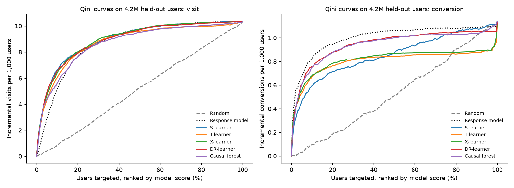
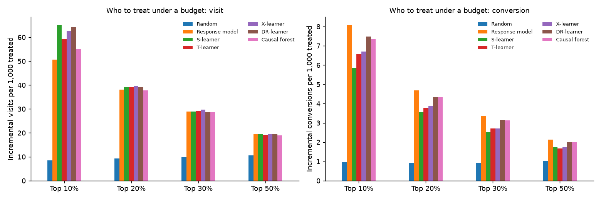

# Case study B: who should see the ad? Uplift modeling on 14 million users

**Data.** [Criteo Uplift Prediction Dataset v2.1](https://huggingface.co/datasets/criteo/criteo-uplift)
(Diemert et al., 2018). 13,979,592 users from a randomized ad experiment: 85% were eligible to see
ads (treatment), 15% were held out (control). 12 anonymised pre-treatment features, plus `visit`
and `conversion` outcomes. "Treatment" means eligible for the ad (intent-to-treat): only 3.6% of
treated users were actually exposed.

**Code.** [`case_studies/criteo/prepare.py`](../case_studies/criteo/prepare.py) (DuckDB conversion,
SQL EDA in [`sql/eda.sql`](../case_studies/criteo/sql/eda.sql), randomization checks) and
[`case_studies/criteo/run_all.py`](../case_studies/criteo/run_all.py) (models, evaluation,
refutations). A fixed hash split puts 70% of users (9.79M) in training and 30% (4.19M) in a test
set that no model sees during training. The full run takes about 15 minutes on a laptop CPU.
Numbers come from [`reports/criteo/`](criteo/).

---

## 1. Checking the experiment before modeling it

| Check | Result |
|---|---|
| Planned split 85/15 | Observed 85.00001% treated. SRM p = 0.999 (so exact that the data was likely resampled to the target ratio) |
| Control users exposed to the ad | 0, as it should be |
| Conversions without a visit | 0 of 40,774 (conversion happens through a visit) |
| Feature balance between arms | Max standardized mean difference 0.049 (f3). Under the usual rule (< 0.1) this is "balanced", but with 1M rows chance alone gives about 0.003, so the gap is real |
| Can features predict who was treated? | Held-out AUC **0.509** (0.5 = pure chance) |

Treatment is close to random, but not exactly random. That matters for the next section.

## 2. Average effect: naive vs covariate-adjusted

| Outcome | Control rate | Difference in means (95% CI) | Doubly robust AIPW (95% CI) | DoWhy linear regression |
|---|---|---|---|---|
| Visit | 3.82% | +1.03 pts (±0.05) | **+0.73 pts (±0.05)** | +0.69 pts |
| Conversion | 0.19% | +0.114 pts (±0.012) | **+0.096 pts (±0.013)** | +0.080 pts |

The simple treated-minus-control difference **overstates the visit effect by about 40%**
(+27% relative lift vs +19%). The small feature imbalance sits on features that strongly predict
visiting, so treated users were slightly more "visit-prone" to begin with. Every adjusted method
agrees on the smaller number:
- linear regression
- AIPW with a constant propensity
- AIPW with an estimated propensity
- inverse-propensity weighting

AIPW (augmented inverse propensity weighting) is the headline because it stays unbiased if
either the outcome model or the propensity model is right. In a cleanly randomized test it would
match the difference in means and simply have a smaller standard error, the same idea as CUPED.

**Refutation tests** (DoWhy, 1M-row sample, 10 simulations each):

| Test | What should happen | Visit | Conversion |
|---|---|---|---|
| Replace treatment with a random placebo | Effect drops to ~0 | 0.0001 | -0.00005 |
| Add a random confounder | Effect unchanged | 0.00693, same as the estimate | 0.00080, same |
| Re-estimate on random 50% subsets | Effect stable | 0.00711 | 0.00078 |

All three pass.

## 3. Who to target: uplift models vs baselines

Models, all with scikit-learn histogram gradient boosting as the base learner:

| Model | Idea |
|---|---|
| Random | Baseline: pick users at random |
| **Response model** | The default many teams use: rank by P(visit \| treated). Predicts who will act, not who will act *because of* the ad |
| S-learner | One model with treatment as a feature |
| T-learner | Separate models for treated and control |
| X-learner | Imputes individual effects, weighted by propensity; built for unequal arm sizes like 85/15 |
| DR-learner | Doubly robust pseudo-outcome, cross-fitted, estimated propensity |
| Causal forest | EconML `CausalForestDML`, trained on a 300k-row subsample (compute limit) |

### Visits

| Model | Qini coefficient (95% CI) | vs response model, paired CI | Incremental visits per 1,000 treated, top 10% | Same, covariate-adjusted | Share of all incremental visits captured by top 20% |
|---|---|---|---|---|---|
| Random | 0.0000 | - | 8.4 | 6.0 | 18% |
| Response model | 0.00354 (0.00334 to 0.00375) | - | 50.6 | 51.9 | 75% |
| S-learner | **0.00381** (0.00362 to 0.00403) | **+0.00018 to +0.00036** | **65.2** | 60.0 | 77% |
| T-learner | 0.00361 (0.00341 to 0.00384) | -0.00014 to +0.00031 | 59.1 | 57.1 | 76% |
| X-learner | **0.00380** (0.00362 to 0.00406) | **+0.00014 to +0.00044** | 62.7 | **60.1** | **78%** |
| DR-learner | 0.00375 (0.00358 to 0.00396) | **+0.00011 to +0.00035** | 64.3 | 60.0 | 77% |
| Causal forest (300k rows) | 0.00352 (0.00331 to 0.00374) | -0.00015 to +0.00009 | 54.9 | 54.2 | 74% |

CIs come from 200 paired Poisson-bootstrap draws on the 4.19M test users. "Covariate-adjusted"
replaces the raw treated-vs-control comparison inside the top-10% group with the mean AIPW score,
which corrects for the imbalance found in section 1.

**Takeaways for visits**
- Three uplift models (S, X, DR) beat the response model with paired 95% CIs above zero.
- The gain is concentrated where budgets are tight. In the top 10%, the X-learner delivers
  **60 incremental visits per 1,000 treated (covariate-adjusted) vs 52 for the response model
  (+16%) and 6 for random targeting (10x)**. At 20% and beyond, all good models converge.
- Treating the top 20% of users chosen by the X-learner captures **78% of all the incremental
  visits** the campaign would produce if it treated everyone.
- The T-learner is the weakest meta-learner: the control arm is small (15%), and errors in two
  separate models add up. The X-learner was designed for this case.

### Conversions (0.3% base rate)

| Model | Qini (95% CI) | vs response model, paired CI | Incremental conversions per 1,000 treated, top 10% (adjusted) |
|---|---|---|---|
| Random | 0.00000 | - | 0.7 |
| **Response model** | **0.00043** (0.00038 to 0.00049) | - | **8.2** |
| DR-learner | 0.00038 (0.00032 to 0.00043) | -0.00010 to -0.00001 | 7.8 |
| Causal forest (300k rows) | 0.00037 (0.00031 to 0.00042) | -0.00012 to -0.00001 | 7.7 |
| X-learner | 0.00025 (0.00018 to 0.00031) | -0.00024 to -0.00012 | 6.8 |
| T-learner | 0.00023 (0.00018 to 0.00030) | -0.00025 to -0.00014 | 6.3 |
| S-learner | 0.00028 (0.00024 to 0.00033) | -0.00020 to -0.00010 | 5.5 |

**For conversions, no uplift model beats the simple response model**, which is significantly
better than all of them. Conversions are rare (about 28,500 in training), so the
treated-vs-control difference that uplift models learn from is very noisy. Meanwhile the effect
of the ad on conversion is roughly proportional to how likely a user is to convert anyway, so
ranking by P(convert | treated) is already a good uplift ranking. This is a real, useful
negative result: use the simpler model here.

## 4. Turning this into a decision (illustrative economics)

Suppose each ad impression costs ₹0.50 and a visit is worth ₹10. These numbers are made up to
show the method; plug in real ones. Treating a user pays off only if their uplift exceeds
0.50 / 10 = 0.05 visits, i.e. 50 incremental visits per 1,000 treated.

| Policy (treat 10% of users) | Incremental visits per 1,000 treated (adjusted) | Profit per 1,000 treated |
|---|---|---|
| Random | 6.0 | 60 - 500 = **-₹440** |
| Response model | 51.9 | 519 - 500 = **+₹19** |
| X-learner | 60.1 | 601 - 500 = **+₹101** |

Under these assumptions, showing the ad to random users loses money, and picking users by
uplift is about 5x more profitable than picking by response.

## Limitations

- Features are anonymised, so models cannot be interpreted in business terms.
- The causal forest was trained on 300k rows because of laptop compute; with the full data it
  may match the meta-learners. An earlier run on a different 300k subsample scored a visit Qini
  of 0.00375, so its results vary noticeably with the subsample.
- Treatment is "eligible for ad", not "saw ad". Effects are intent-to-treat; the effect of
  actually seeing the ad is larger (only 3.6% of treated users were exposed).
- The standard Qini curves use raw treated-vs-control comparisons, which carry the small imbalance
  from section 1. The covariate-adjusted columns are the robustness check, and the model ranking
  does not change.
- One test split, no hyperparameter tuning: the base learner uses the same fixed settings
  everywhere, so model comparisons are fair but not maximised.
